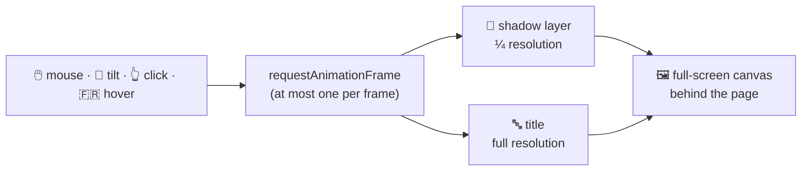
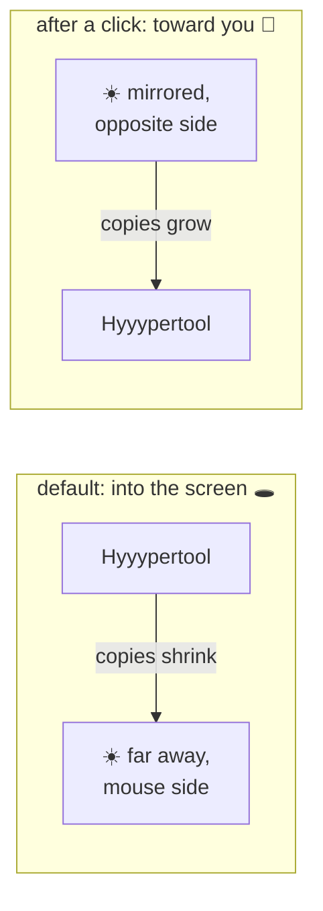
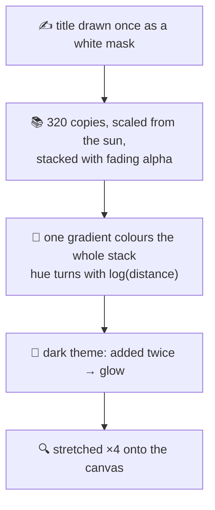
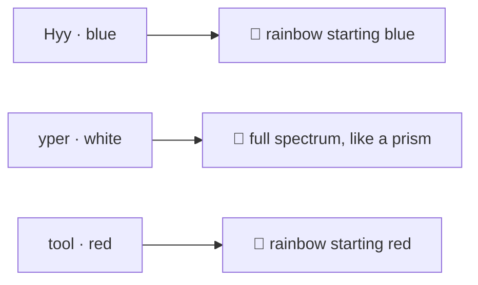

# ☀️ Sunlight: the HyyyperDay of 24 November 2026

## 🎯 What

The title is a solid object lit by a sun. You move the sun, and the title casts a rainbow shadow across the whole screen.

| You do                                   | It does                                                                               |
| ---------------------------------------- | ------------------------------------------------------------------------------------- |
| 🖱️ move the mouse (or 📱 tilt the phone) | the shadow points that way                                                            |
| 👆 click anywhere                        | the shadow flips depth: into the screen ↔ out toward you                              |
| 🇫🇷 hover "S'identifier avec ProConnect"  | the title salutes in blue · white · red, each colour diffracting into its own rainbow |

## 🤔 Why

The earlier HyyyperDays play once and stop. This one is a toy that stays: nothing moves until you do. 🎈

## 🛠️ How

### 🌗 Two depths, one direction

The mouse gives a **direction**, never a position. The click only picks where the sun stands.

### 🌈 The shadow, step by step

### 🇫🇷 The salute

The rainbow and the salute cross-fade over 400 ms.

## ⚡ Speed

The first version drew 200 full-resolution copies per frame (~1 gigapixel) and took about 2 s per mouse move. 🐢

Now the title is rasterised once, the shadow is drawn at ¼ resolution, and the page only redraws on input. 🐇

## ♿ Accessibility

- The `<h1>` stays in the DOM for screen readers and without JS.
- `prefers-reduced-motion`: the shadow is drawn once and does not follow the mouse.
